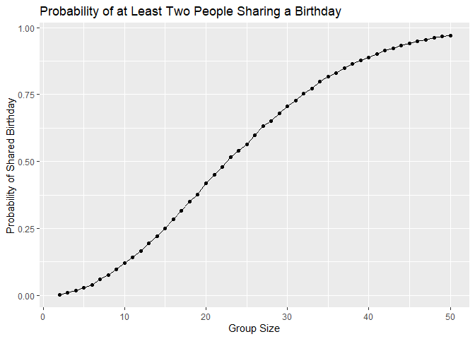
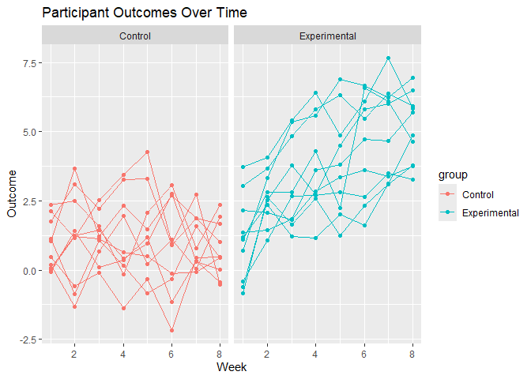
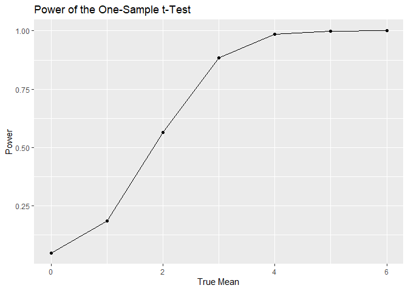
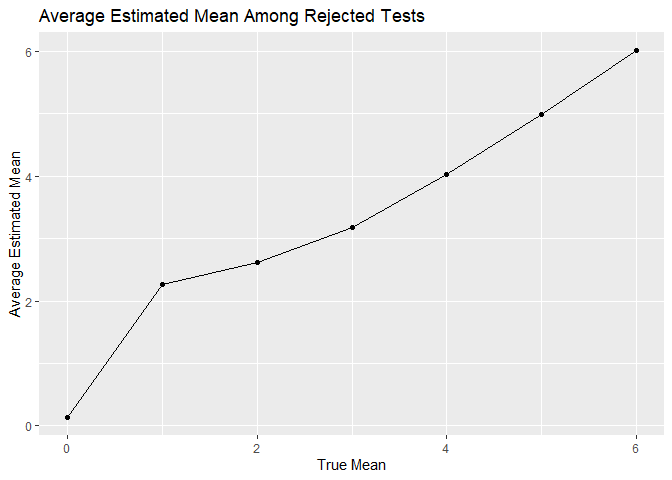

p8105_hw5_jl7322
================
Claire Liu
2026-11-17

## Problem 1

Creating a function to simulate birthdays for a group of a given size
and determine whether at least two people share a birthday.

``` r
birthday_simulation = function(n){
  birthday = sample(1:365, size = n, replace = TRUE)
  any(duplicated(birthday))
}
```

Run this function 10000 times for each group size between 2 and 50.

``` r
birthday_result = 
  expand_grid(
    group_size = 2:50,
    iteration = 1:10000
  ) |> 
  mutate(
    duplicate = map_lgl(group_size, birthday_simulation)
  )
```

Calculated the estimated probability for each group size and plotted the
results.

``` r
birthday_summary = 
  birthday_result |> 
  group_by(group_size) |> 
  summarize(
    probability = mean(duplicate)
  )

birthday_summary |> 
  ggplot(aes(x = group_size, y = probability)) +
  geom_line() +
  geom_point() +
  labs(
    x = "Group Size",
    y = "Probability of Shared Birthday",
    title = "Probability of at Least Two People Sharing a Birthday"
  )
```

<!-- -->

##### Conclusion

The probability of at least two people sharing a birthday increases
rapidly as group size increases. The probability is about 0.5 when the
group size is around 23 and increases to about 0.97 when the group size
reaches 50.

## Problem 2

Created a dataframe containing the file names for all participants.

``` r
longitudinal_df = 
  tibble(
    files = list.files("data/"),
    path = str_c("data/", files)
  ) |> 
  mutate(data = map(path, read_csv)) |> 
  unnest(data)
```

Tidied the data by extracting treatment group and subject ID from the
file names and converting the weekly observations from wide to long
format.

``` r
tidy_df =
  longitudinal_df |>
  mutate(
    files = str_replace(files, ".csv", ""),
    group = str_sub(files, 1, 3)
  ) |>
  
  pivot_longer(
    week_1:week_8,
    names_to = "week",
    values_to = "outcome",
    names_prefix = "week_"
  ) |>
  
  mutate(
    week = as.numeric(week),
    group = case_match(
    group,
    "con" ~ "Control",
    "exp" ~ "Experimental"
    )
  ) |> 
  select(group, subj = files, week, outcome)
```

    ## Warning: There was 1 warning in `mutate()`.
    ## ℹ In argument: `group = case_match(group, "con" ~ "Control", "exp" ~
    ##   "Experimental")`.
    ## Caused by warning:
    ## ! `case_match()` was deprecated in dplyr 1.2.0.
    ## ℹ Please use `recode_values()` instead.

Then created a spaghetti plot to show observations on each subject over
time.

``` r
tidy_df |>
  ggplot(aes(x = week, y = outcome, group = subj, color = group)) +
  geom_point() +
  geom_path() +
  facet_grid(~group) +
  labs(
    x = "Week",
    y = "Outcome",
    title = "Participant Outcomes Over Time"
  )
```

<!-- -->

##### Conclusion

The control group shows relatively little overall change across the
eight weeks. In contrast, participants in the experimental group
generally show increasing outcome values over time.

## Problem 3

Created a function to simulate a sample of 30 observations and perform a
one-sample t-test.

``` r
sim_t_test = function(mu) {
  sim_data =
    tibble(
      x = rnorm(30, mean = mu, sd = 5)
    )
  
  test_result =
    t.test(
      sim_data |> pull(x),
      mu = 0
    ) |>
    broom::tidy()
  
  test_result |>
    select(estimate, p.value)
}
```

Repeated the simulation 5000 times for each true mean from 0 to 6.

``` r
sim_results =
  expand_grid(
    mu = 0:6,
    iteration = 1:5000
  ) |>
  mutate(
    result = map(mu, sim_t_test)
  ) |>
  unnest(result)
```

Then calculated the power of the test for each true mean and make the
plot.

``` r
power_results =
  sim_results |>
  group_by(mu) |>
  summarize(
    power = mean(p.value < 0.05)
  )

power_results |>
  ggplot(aes(x = mu, y = power)) +
  geom_line() +
  geom_point() +
  labs(
    x = "True Mean",
    y = "Power",
    title = "Power of the One-Sample t-Test"
  )
```

<!-- -->

##### Conclusion

Power increases as the true mean moves farther from 0. When $\mu = 0$,
the rejection rate is close to 0.05, while larger effect sizes lead to
much higher power, approaching 1 by about $\mu = 4$.

Next, I calculated the average estimate of mu for each true mean and
make the plot.

``` r
mean_estimates =
  sim_results |>
  group_by(mu) |>
  summarize(
    mean_estimate = mean(estimate)
  )

mean_estimates |>
  ggplot(aes(x = mu, y = mean_estimate)) +
  geom_line() +
  geom_point() +
  labs(
    x = "True Mean",
    y = "Average Estimated Mean",
    title = "Average Estimated Mean vs. True Mean"
  )
```

<!-- -->

Next, I calculated the average estimate only among simulations in which
the null hypothesis was rejected and make the plot.

``` r
rejected_estimates =
  sim_results |>
  filter(p.value < 0.05) |>
  group_by(mu) |>
  summarize(
    mean_estimate = mean(estimate)
  )

rejected_estimates |>
  ggplot(aes(x = mu, y = mean_estimate)) +
  geom_line() +
  geom_point() +
  labs(
    x = "True Mean",
    y = "Average Estimated Mean",
    title = "Average Estimated Mean Among Rejected Tests"
  )
```

<!-- -->

The average estimated mean across all simulations is approximately equal
to the true mean. However, among simulations where the null hypothesis
is rejected, the average estimate is larger than the true mean for
smaller effect sizes because only more extreme estimates are likely to
produce significant results. As the true mean increases and power
approaches 1, this difference becomes much smaller.
