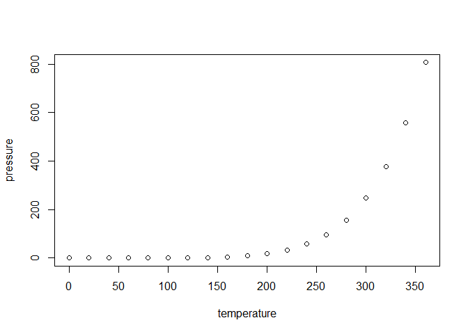

p8105_hw5_jl7322
================
Claire Liu
2026-11-17

## Problem 1

Creating a function to simulate birthdays for a group of a given size
and determine whether at least two people share a birthday.

``` r
birthday_simulation = function(n){
  birthday = sample(1:365, size = n, replace = TRUE)
  any(duplicated(birthday))
}
```

Run this function 10000 times for each group size between 2 and 50.

``` r
birthday_result = 
  expand_grid(
    group_size = 2:50,
    iteration = 1:10000
  ) |> 
  mutate(
    duplicate = map_lgl(group_size, birthday_simulation)
  )
```

Calculated the estimated probability for each group size and plotted the
results.

``` r
birthday_summary = 
  birthday_result |> 
  group_by(group_size) |> 
  summarize(
    probability = mean(duplicate)
  )

birthday_summary |> 
  ggplot(aes(x = group_size, y = probability)) +
  geom_line() +
  geom_point() +
  labs(
    x = "Group Size",
    y = "Probability of Shared Birthday",
    title = "Probability of at Least Two People Sharing a Birthday"
  )
```

<!-- -->

Conclusion: The probability of at least two people sharing a birthday
increases rapidly as group size increases. The probability is about 0.5
when the group size is around 23 and increases to about 0.97 when the
group size reaches 50.

## Including Plots

You can also embed plots, for example:

<!-- -->

Note that the `echo = FALSE` parameter was added to the code chunk to
prevent printing of the R code that generated the plot.
